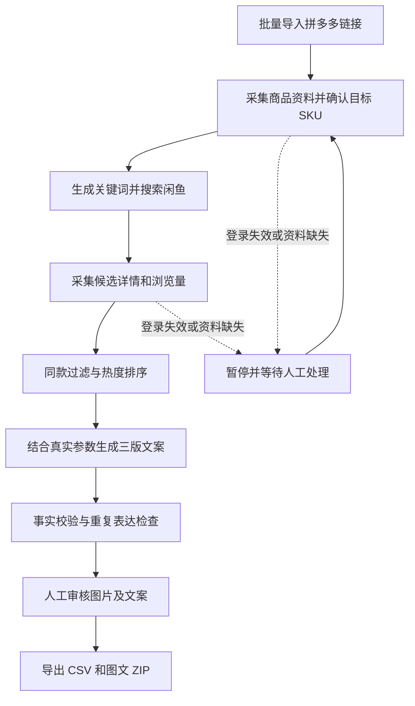

# 拼多多 → 闲鱼选品图文工作流

使用 n8n 编排拼多多商品采集、闲鱼同款筛选和文案生成，经过人工审核后导出图文包。

**当前交付：初始技术方案 v0.1（2026-10-16）。仓库尚未包含可运行的采集服务或可导入的 n8n 工作流。** 方案中的接口、数据结构和阈值是待实现约定，不代表平台官方接口或已验证的采集能力。

## 目标流程

图中的恢复箭头表示继续业务流程；实际从保存的失败阶段恢复，不重新执行所有已完成步骤。

## 技术选择

| 层 | 技术 | 职责 |
|---|---|---|
| 流程编排 | n8n | 导入、分发、分支、等待、模型调用、审核入口、错误记录 |
| 业务接口 | Python + FastAPI | 状态与版本管理、幂等接口、权限检查 |
| 长任务执行 | Celery + Redis | 浏览器任务、图片处理和导出；不负责业务 DAG |
| 采集 | Playwright，按平台独立适配 | 拼多多详情、闲鱼搜索与详情 |
| 业务数据 | PostgreSQL | 商品快照、任务、候选、草稿、审核、导出记录 |
| 文件 | 初期持久化目录，后续对象存储 | 图片和导出包；n8n 只传引用 |
| 生成 | n8n 调用模型 API | 一次生成三个表达版本；输入输出采用结构化数据 |
| 部署 | Docker Compose | 单机起步，固定版本，不以浮动 latest 作为生产部署约定 |

n8n 使用自己的数据库，与业务库分开。首版不开 n8n queue mode；Redis 首先只作为 Python worker 的消息队列。

## 阅读顺序

1. [技术架构与业务规则](docs/architecture.md)：边界、数据质量、同款及热度规则。
2. [n8n 节点与工作流](docs/workflows.md)：每条流程的节点、分支和恢复行为。
3. [接口与数据约定](docs/contracts.md)：Python 接口、持久化模型、幂等及状态机。
4. [实施计划与验收](docs/implementation.md)：阶段交付、采集试验、预算与运行要求。
5. [文案生成提示词](prompts/copy-generation.md)及[草稿 Schema](schemas/draft.schema.json)。

## 当前边界

- 货源平台已确定为拼多多；每日数量、具体品类、真实链接、目标 SKU 和模型供应商尚未确认。
- 不默认承诺普通拼多多分享链接都能由官方开放接口解析；先用真实样本验证覆盖率。
- 闲鱼只在本次搜索取得的候选内比较浏览量，不宣称全站排名；想要人数不是浏览量或销量。
- 第一版终点是审核后导出，不包含自动发布、自动下单或自动联系其他卖家。
- 竞品图文用于同款判断及表达参考；导出图片要求有可用的授权记录或属于自有素材。
- `ai-goofish-monitor` 仅作为功能和源码研究参考，当前仓库未复制其代码，也未继承其许可证。

## 资料依据

- [n8n 流程控制](https://docs.n8n.io/build/flow-logic.md)
- [n8n Webhook](https://docs.n8n.io/integrations/builtin/core-nodes/n8n-nodes-base.webhook/)
- [n8n Wait](https://docs.n8n.io/integrations/builtin/core-nodes/n8n-nodes-base.wait/)
- [n8n 错误工作流](https://docs.n8n.io/build/flow-logic/handle-errors-gracefully.md)
- [n8n Structured Output Parser](https://github.com/n8n-io/n8n-docs/blob/main/docs/integrations/builtin/cluster-nodes/sub-nodes/n8n-nodes-langchain.outputparserstructured/README.md)
- [Playwright 网络响应读取](https://playwright.dev/python/docs/network)
- [Celery](https://docs.celeryq.dev/en/stable/getting-started/introduction.html)
- [闲鱼参考项目字段读取，固定提交](https://github.com/Usagi-org/ai-goofish-monitor/blob/77f8d75869acd65f9dba72731b95c7c49ea67bdf/src/scraper.py#L1090-L1114)
- [拼多多开放平台](https://open.pinduoduo.com/application/document/api)：本次未获得足以确认普通链接覆盖范围的官方接口正文。
- [n8n 授权说明](https://support.n8n.io/article/can-i-use-your-license-for-my-use-case)：内部使用与对外提供工作流编辑、白标服务的授权条件不同。

核查日期：2026-10-16。实施时记录 n8n、Python 依赖及浏览器的实际固定版本，并在该版本验证节点配置。当前文档不是逐版本兼容性承诺。
