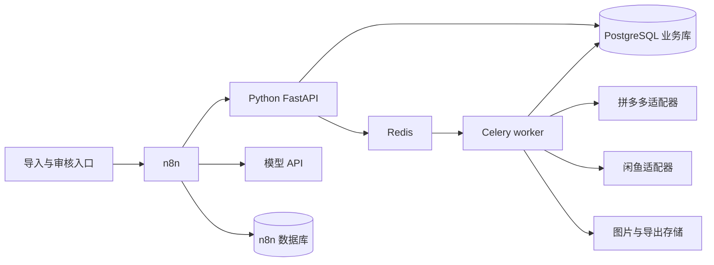

# 技术架构与业务规则

## 1. 最小业务闭环

输入商品链接列表和卖家自己的销售条件，输出：

- 拼多多商品资料及所选 SKU 的可追溯快照。
- 闲鱼候选链接、同款判断、浏览量、想要人数、价格、采集时间。
- 候选池内的浏览量排名及缺失数据提示。
- 三版标题和正文、事实引用、检查结果。
- 经人工确认的一版文案及可发布图片包。

所有步骤可以追溯到来源链接、采集时间、规则版本和文案版本。价格、规格、成色、交付承诺不能仅由竞品文案推断。

## 2. 系统边界

### n8n 负责

- 接收导入请求，按计划领取待处理商品，调用子工作流。
- 调用 Python 的异步接口，等待并查询任务进度，按返回状态分流。
- 获取已经清洗、限制长度的生成上下文，调用模型，提交结构化草稿。
- 接收审核操作，调用审核接口；导出批准版本。
- 记录执行异常，并以定时恢复流程兜底。

### Python 必须负责

| 模块 | 必须独立实现的内容 |
|---|---|
| `sources/pdd` | 分享文本提取 URL、短链解析、商品标识归一、详情读取、SKU 与图片对应 |
| `sources/xianyu` | 搜索、翻页、详情读取、图片与热度字段提取、登录状态识别 |
| `assets` | 下载、校验 MIME 和尺寸、文件去重、来源和使用权限记录 |
| `matching` | 属性归一、硬冲突排除、候选分类与证据输出 |
| `ranking` | 缺失值处理、候选去重、浏览量排序、确定性并列规则 |
| `drafts` | JSON Schema 校验、事实引用检查、参数冲突和重复表达检测 |
| `jobs` | 持久化、幂等、重试、运行租约、断点恢复 |
| `exports` | 按批准版本生成 ZIP/CSV、建立素材清单与版本校验 |

这些逻辑留在 Python，便于平台变化时单独更新和测试。n8n 的 Code 节点仅做轻量字段整理，不保存 Cookie、不解析复杂商品页面、不运行浏览器。

## 3. 拼多多资料采集

优先评估具备实际权限的官方或授权数据渠道。无法覆盖的链接再验证浏览器读取；仍无法取得的字段进入人工补录，不能用模型编造。

采集输出包括：商品 ID、规范链接、标题、主图、详情图、SKU 列表、选定 SKU、对应价格和规格、采集时间、字段来源。

- 原始分享文本和规范 URL 分开保存；统计同一商品的重复输入。
- 原始价格展示文本与结构化价格分开保存，金额用整数分；记录拼团/单买/优惠条件和时间。
- 当链接有多个 SKU 且用户没有选定时，暂停为 `needs_input`。首版不自动选择最低价款。
- 选定 SKU 后形成 `source_revision`。后续更换规格、价格或销售条件必须建立新版本，并使旧草稿审批失效。
- 详情图文字可按需用 OCR 辅助提取，但必须保留证据图片和置信度；低置信度字段不作为发布事实。
- 商品页面内容属于不可信输入，只作为数据处理；页面中的指令不得改变系统提示词或调用工具。

## 4. 闲鱼搜索与同款判断

先基于可信字段生成 2–3 组查询，例如品牌型号、品类加规格、通用名加关键属性。关键词整理可以用规则，缺乏规则时再引入模型。

建议初始上限：每件源商品合计最多 30 个去重搜索候选、最多 10 个详情请求、最多选 3 个参考商品。这些是成本控制参数，不是平台允许的请求频率，也不是效果承诺。

按以下顺序处理：

1. 搜索结果按闲鱼 item ID 去重，保留命中关键词和结果位置。
2. 用标题做廉价的明显冲突过滤；同一商品多个结果只读取一次详情。
3. 在详情预算内读取图片、说明、浏览量和想要人数。
4. 对照所选 SKU 做属性匹配；不足以确定的候选归为待核实。
5. 只给确认同款的候选做浏览量排名。

### 同款分类

| 分类 | 判定要求 | 后续处理 |
|---|---|---|
| `exact` | 关键型号/规格一致，且有足够来源证据 | 允许进入排名 |
| `possible` | 外观或标题相似，但缺少关键属性 | 由人工确认；不自动当作同款 |
| `different` | 品牌、型号、尺寸、容量、件数等存在硬冲突 | 排除 |

按品类维护关键属性表。例如数码类关注型号、容量，家具关注尺寸和材质，耗材关注规格和件数。图片相似只作为辅助证据；同一供应商主图也可能对应不同规格。

首版采用规则加人工确认。只有规则无法覆盖的品类再引入多模态模型；它返回匹配理由和证据，不允许覆盖已发现的硬冲突。

## 5. 热度排序

首版默认排序：`exact` 候选中，按可取得的浏览量降序；并列按想要人数降序，再按 item ID 稳定排序。缺失想要人数不计作零并排在已知值之后。

- 缺失浏览量记为 `null`，保留缺失原因；没有浏览量的候选放在“热度未知”区域。
- 浏览量、想要人数、销量是三个不同字段。任何替代指标必须显式标注，默认不启用替代排序。
- 保留 `raw_text` 和 `precision`；例如“1.2万”是近似显示值，应标记 approximate。
- 如所有同款候选都缺浏览量，暂停为 `needs_input`，让用户选择补充候选或明确接受仅按相关性参考。
- 如没有同款，不能把“相似品”自动升级为同款。可人工确认候选，或明确选择只根据源商品生成。
- 先按闲鱼商品 ID 去重。若多个链接图文高度重复，可聚类展示并取一个参考样本，但保留原始统计。
- 后续可用两次快照计算新增浏览量；只有同一商品、可比较的指标、已知时间间隔才能计算增长率。浏览量不能证明文案导致流量增长。

界面和导出写“采集候选内浏览量排名”，并显示查询词、候选数量、详情覆盖率、采集时间。

## 6. 文案与素材

模型输入分成三块：

1. **商品事实**：所选 SKU、规格、确认的卖点，逐条有 `fact_id` 和来源。
2. **卖家条件**：真实售价、成色、配送和售后，来自用户自己的销售资料。
3. **参考表达**：最多 3 个同款样本的卖点和场景；不能用于证明自己的成色、经历或售后。

使用固定的生成流程，一次输出三版文案；首版不使用具有自主工具调用权限的 Agent。模型供应商、模型名和提示词版本均写入生成记录。

Python 做结构化校验、引用有效性和显式属性冲突检查。重复表达先用归一化后的字符片段比较，对规格型号等必要相同文本单独处理；语义相似度在有标注样本后再加。阈值需实测，不承诺任何平台的判重结果。

一件商品默认最多两次模型调用：首次生成和一次修正。仍不通过的草稿保存并标记 blocking issues，进入人工编辑，禁止直接批准。结构校验不能证明自然语言陈述全部真实，最终仍需审核。

图片按用途区分 `reference` 与 `publishable`。下载成功不代表可发布；导出只接受 `rights_status=owned|authorized` 且有来源记录的素材。不默认移除水印或把竞品图片混入发布包。

## 7. 运行原则

- 一个来源账号的浏览器任务默认串行；全局并发从 1 起步，经真实试验再调整。
- 登录失效、验证挑战、权限拒绝均暂停相应账号任务，等待用户处理；不进行无限重试。
- API 返回任务 ID，n8n 查询任务状态。长任务不占用一个持续的 HTTP 请求。
- 所有业务数据通过 Python API 写入；n8n 不直接更新业务表，避免两处维护状态机。
- 业务库是恢复依据，n8n 执行历史用于排查；两者通过 run ID、job ID 和 execution ID 关联。
