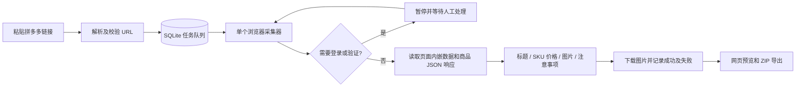

# MVP 01 实现文档：拼多多商品资料采集

## 1. 本次范围与交付状态

本版按用户确认的分步方案实施：输入一条拼多多商品链接或分享文本，获取商品资料，下载图片，按以下四项展示和导出：

1. 标题。
2. 商品规格及对应价格。
3. 商品图片，包括可识别的主图、规格图、详情图。
4. 商品注意事项。

已提供本地网页、Python API、浏览器采集器、结构化解析器、图片下载器、SQLite 任务记录和 ZIP 导出。当前属于**可运行、使用合成数据验证的采集首版，真实拼多多链接验收待完成**。用户稍后提供样本；不以合成测试证明平台当前可采集率。

本版不接入闲鱼，不做文案生成、审核或发布；不需要模型 API。原有 `architecture.md`、`contracts.md`、`workflows.md`、`implementation.md` 继续作为后续完整工作流的方案，首版实际行为以本文和代码为准。本次没有修改云端 n8n 部署，也没有部署业务工作流。

## 2. 本机启动与操作

当前实现面向 macOS / Linux 单机单用户使用；文件锁使用 `fcntl`，Windows 暂不支持。需要 Python 3.12+、uv 和 Google Chrome。依赖的精确版本在 `uv.lock` 中。

在项目根目录运行：

```bash
uv sync --frozen
uv run python -m app
```

打开 `http://127.0.0.1:8787/`。首次启动会自动创建本机访问口令，另开终端读取：

```bash
cat .local/pdd-mvp/access-token
```

将口令粘贴到页面登录。口令文件权限为 `0600`，浏览器登录 Cookie 为 HttpOnly / SameSite Strict。服务默认只监听 `127.0.0.1`；这不是公网多用户服务。

使用顺序：

1. 粘贴单个商品链接或含一个商品链接的分享文本，点击“解析并采集”。
2. 程序打开独立 Chrome 窗口，访问页面并保存该专用浏览器的登录状态。不会读取日常 Chrome 资料目录。
3. 如出现登录或验证，在采集窗口人工处理，再回工作台点“继续采集”。程序不自动处理验证码。
4. 查看四项资料及缺失提示，点击图片可以查看原尺寸下载结果。
5. 点击“下载资料与全部已取得图片”，取得 ZIP。
6. 任务失败、部分完成或服务中断后，可以重新采集。重新采集会重新读取页面和下载图片，不承诺只补失败文件。

端口可改为：

```bash
uv run python -m app --port 8788
```

可选环境变量：

| 名称 | 默认值 | 用途 |
|---|---|---|
| `PDD_DATA_DIR` | `.local/pdd-mvp` | 数据、图片、ZIP、浏览器资料目录 |
| `PDD_LOCAL_TOKEN` | 自动生成文件口令 | 使用自己的至少 24 字符本机口令；设置后不创建口令文件 |
| `PDD_BROWSER_CHANNEL` | `chrome` | 已安装的 Chrome；空字符串表示使用 Playwright 自带 Chromium |
| `PDD_HEADLESS` | `0` | `1` 开启无头模式，仅适合不需要人工登录的情况或测试 |

没有 Google Chrome 时，可先安装 Playwright Chromium：

```bash
uv run playwright install chromium
PDD_BROWSER_CHANNEL='' uv run python -m app
```

不要加 `--reload` 或启动多个 worker。服务会对数据目录加进程锁，防止多个采集器同时操作同一个浏览器资料目录。

## 3. 实现结构

```text
app/
  __main__.py           本地启动入口，固定绑定回环地址
  main.py               页面、登录、任务、继续采集、图片和 ZIP API
  storage.py            SQLite 持久化、提交幂等、原子领取和重启恢复
  links.py              分享文本 URL 提取、平台域名和公网 IP 校验
  collector.py          串行 Playwright worker、登录暂停、页面滚动和数据监听
  parser.py             商品数据归一化、SKU 价格、图片分类、注意事项提取
  downloads.py          图片校验/下载/去重、CSV 和 ZIP 生成
  static/               无前端构建步骤的 HTML / CSS / JavaScript 工作台
tests/
  fixtures/product.json 明确标注为虚构的商品测试数据
  test_parser.py        链接和商品解析规则
  test_downloads.py     下载、重定向、格式、大小、去重和资料包
  test_api.py           鉴权、任务、幂等、恢复与并发领取
  test_collector.py     登录识别及原任务恢复
  test_browser.py       可选的真实 Chrome 合成页面端到端验收
```



短任务规模下，SQLite 和单线程 worker 已能完成首版所需的排队与持久化，因此暂未引入 PostgreSQL、Redis、Celery。长任务在专门线程运行，API 提交后立即返回任务 ID；网页每 2.5 秒查询状态。

## 4. 商品获取和解析规则

### 链接

支持拼多多及 `yangkeduo.com` 域下的 HTTP/HTTPS 链接，统一使用 HTTPS。可提取完整分享文本中的 URL，重复出现的相同 URL 只计一次；多个不同平台商品 URL 会要求拆开提交。

`goods_id` 长链直接提取商品标识，`ps` 等短链接由浏览器正常导航和重定向解析。能提取短链接不意味着一定能读出完整商品；分享页、App 专属页、失效页均可能无法获取数据。

### 页面与来源

读取页面 `window.rawData` / `window.__INITIAL_STATE__`、可解析的内嵌 JSON，以及页面正常请求取得的商品 JSON 响应。商品选择基于受限容器路径与商品 ID，不递归抓取推荐商品数组。解析器不会自行调用签名私有接口，也不会把脚本文本交给 `eval` 执行。

浏览器会尝试点击明确的“商品详情 / 图文详情”入口并滚动加载。滚动上限为 24 次，每次约 800 像素，达到上限而页面仍未稳定时提示可能有遗漏。不点击购买、支付或下单控件。

保存的是归一化商品数据及字段来源路径，不保存完整响应、Cookie 或整页 HTML 到导出包。

### 标题与规格价格

- 标题来自目标商品的 `goods_name` / `goodsName`。
- SKU 保留标识、规格属性、拼团价、单买价、其他价格原值、库存原值和价格条件。
- `group_price` / `normal_price` / `price_in_cents` 按适配器约定解析整数分；真实样本到位后必须核对单位。
- `groupPrice` 等不同来源可能使用不同单位的字段，保留原值并标记“单位待核实”，不猜测换算。
- 缺失值与 0 区分；缺少规格不会套用商品最低价。
- 规格标识或名称不完整、同一 SKU 快照价格有冲突时，结果需要核对，不能标为完整。

### 图片

提取明确的商品图集、详情图集与各 SKU 图片字段。相同 URL 合并来源分类；不同 URL 下载到相同内容时按 SHA-256 只保存一个文件。保留原始下载字节，不去水印、不重新压缩、不生成新图片。

每个图片记录包含来源 URL、类别、关联 SKU、来源字段、下载状态、文件相对路径、内容哈希、字节数和尺寸。失败记录保留原因，不会因为其他图片成功而被丢弃。

“全部图片”在当前实现中指**本次页面数据中识别到的所有商品图片**，并逐张尝试下载；尚不能保证覆盖平台隐藏、未加载或适配器不识别的图片。用户样本验收时必须逐类对比原页面。

单次下载限制：最多 300 张、单张 15 MB、累计落盘 300 MB、图片下载阶段约 10 分钟；单次网络读超时 20 秒。达到限制的图片会记录失败并使任务成为部分完成。图片支持 JPEG、PNG、WebP、GIF，使用 Pillow 验证实际格式；明显超大像素图会被拒绝。

### 注意事项

从商品描述、购买提示、服务说明等已知字段提取文字，并补充页面上包含“注意事项 / 温馨提示 / 购买须知”等词的可见文本。可见文本补充项标记为“请人工核对”，不解释为经过人工确认的商品事实。

不使用模型编写注意事项。页面无文字时显示“未取得”，不表示商品没有使用限制。首版未实现 OCR；仅存在于详情图内的尺寸、禁忌、安装说明等，需要查看已下载的详情图。OCR 是否纳入下一步，在真实样本到位后按需要决定。

## 5. 状态、恢复与下载

| 状态 | 含义与操作 |
|---|---|
| `queued` | 已入库，等待串行处理 |
| `running` | 正在打开页面、读取数据或下载图片 |
| `needs_login` | 等待人工登录/验证；点击继续采集 |
| `completed` | 标题、规格、已知单位价格、识别图片、详情图和注意事项均已取得，页面滚动结束；仍需人工核对真实完整性 |
| `partial` | 已取得一部分资料，可下载，缺失项明确显示；可重新采集 |
| `failed` | 未取得可用商品数据或运行失败，可重新采集 |
| `interrupted` | 上次采集期间服务退出，可重新采集 |

登录窗口保留约 10 分钟；超时关闭窗口，任务继续保留在 `needs_login`，下一次点击会重新打开。默认不会无限自动重试。

任务数据持久化在 SQLite 中；同一 `Idempotency-Key` 和规范 URL 返回同一任务，不重复入队。相同键配不同 URL 返回错误。使用新键可以主动重新采集同一商品。任务领取在事务中完成，重复领取不会产生两个执行。

重启后 `queued` 任务继续排队，原 `running` 任务转为 `interrupted`；人工暂停不自动解除。重新采集会更新同一任务的当前结果，首版不保留完整历史版本。单个等待登录的任务会暂时占用串行采集器。

ZIP 内容：

```text
product.zip
  product.txt           按四项整理的可读资料，以及参数和缺失提示
  product.json          结构化商品、字段来源、时间、下载状态、适配器版本
  skus.csv              UTF-8 BOM 编码的规格价格表
  images/<sha256>.<ext>  成功下载的原始图片文件，按内容去重
```

CSV 对可能被电子表格解释为公式的文本做前缀转义。ZIP 只收录本次结果引用的图片，不收录旧任务残留文件、浏览器资料或访问口令。

## 6. 首版 API

除了健康检查、静态页面和登录外，API 使用登录 Cookie 或 `Authorization: Bearer <本机口令>`。接口定义可在本机 `/docs` 查看。

| 方法与路径 | 用途 |
|---|---|
| `GET /healthz` | 服务存活检查 |
| `POST /api/session` | 提交 `{ "token": "本机口令" }` 登录 |
| `DELETE /api/session` | 清除登录 Cookie |
| `POST /api/jobs` | 提交 `{ "text": "链接或分享文本" }`；必须带 `Idempotency-Key`；返回 202 |
| `GET /api/jobs` | 最近 100 条任务摘要 |
| `GET /api/jobs/{id}` | 当前任务状态及结构化商品结果 |
| `POST /api/jobs/{id}/resume` | 从登录暂停、失败、部分完成或中断状态重新执行 |
| `GET /api/jobs/{id}/download` | 下载当前资料 ZIP，未生成时返回 409 |
| `GET /api/jobs/{id}/images/{index}` | 查看当前结果中已下载图片 |

首版路径是 `/api`，不是后续完整工作流方案里的 `/v1`。尚未提供外部 n8n 服务身份；不要把本机口令和浏览器资料上传到 n8n 执行记录。

## 7. 存储、网络与运行约束

```text
.local/pdd-mvp/
  access-token
  worker.lock
  jobs.sqlite3          运行中可能同时有 WAL / SHM 文件
  browser-profile/      专用 Chrome 会话资料
  products/<job-id>/     商品 JSON / TXT / CSV / ZIP 及 images/
```

`.local/` 已被 Git 忽略。需要备份时先停止服务，再复制整个数据目录；浏览器资料和口令应按敏感本机数据保管。首版没有自动清理历史任务或旧图片，使用后可在停机状态下按任务目录清理，并保留所需 ZIP。

URL 接收、浏览器请求和图片重定向均限制为平台及已知资源域；解析到非公网 IP 时拒绝访问。图片下载不转发浏览器 Cookie，重定向最多 5 次，私网或外部域重定向会失败。需要 Cookie 才能下载的资源会明确失败，后续按样本调整。

该域名/IP 检查是本地工具的基础边界，并非公网任意 URL 抓取服务的完整网络隔离。浏览器 DNS 解析和请求不做 IP 固定；若未来部署为公网服务，应另加网络出口隔离、用户权限、配额及会话隔离。

## 8. 验证方式与当前记录

普通自动化测试，无需访问真实商品：

```bash
uv run pytest -q
uv run ruff check app tests
node --check app/static/app.js
```

真实 Chrome 加合成商品页的端到端测试：

```bash
RUN_BROWSER_TESTS=1 uv run pytest -q tests/test_browser.py
```

浏览器测试会启动临时本地 HTTP 服务；采集浏览器的商品请求由测试夹具替代，图片使用合成图片，测试不调用真实拼多多账户。测试目录使用临时目录，不污染本机工作台商品记录；截图保存在忽略的 `.local/test-preview.png`。

当前已覆盖：分享文本与短链提取、外域及内网拒绝、商品 ID 隔离、规格价格缺失与冲突、未知单位与零值、图片分类/去重/失败清单/重定向/大小限制、资料包内容、登录访问、提交幂等、并发领取、重启恢复、登录暂停继续。本次验证结果：

| 检查 | 结果 |
|---|---|
| 普通 pytest | 30 项通过，1 项浏览器测试默认跳过 |
| 可选 Chrome 端到端测试 | 1 项通过（合成页面采集 → 图片落盘 → 真实本地 API → 登录、四项展示、ZIP 下载、窄屏布局、错误提示、再次提交、退出） |
| Ruff 与 JavaScript 语法检查 | 通过 |
| 真实拼多多链接采集 | 尚未执行，等待用户提供样本 |

测试使用锁定的 Playwright 1.64.0、FastAPI 0.150.0、Pillow 12.3.0；完整依赖版本见 `uv.lock`。

依赖测试中 FastAPI/Starlette 的 TestClient 对 httpx 发出弃用提示，不影响当前测试通过；后续升级测试客户端时单独处理。

## 9. 提供真实链接后的验收清单

用户提供 1–3 条真实商品链接后，首先完成小样本核对：

- 一条正常商品长链、一条分享短链，以及有多规格/较多详情图的商品。
- 标题和商品 ID 是否对应目标商品，不能混入推荐商品。
- 每个 SKU 的规格、拼团价、单买价和优惠条件是否与原页面一致；重点确认价格单位。
- 主图、SKU 图、详情图分别核对数量；识别到的所有图片是否下载成功，失败是否有原因。
- 注意事项是否来自本商品，图片内是否还有必须补充的说明。
- 登录/验证流程是否可正常继续，重启后能否恢复未完成任务。
- ZIP 是否可打开、图片是否完整，CSV 中中文和价格显示是否正确。

真实页面可能需要新增字段适配、补充详情/SKU 展开行为或 CDN 域名；届时以实际读取到的样本调整，并加入脱敏 fixture 回归测试。以上验收完成前，不报告“真实采集已验证”或“所有图片保证完整”。

## 10. 实现参考

- [Playwright Python 官方项目](https://github.com/microsoft/playwright-python)：本次通过 find-docs / Context7 核实同步 API、持久化上下文、响应读取和请求路由方式。
- [Playwright Python 网络文档](https://playwright.dev/python/docs/network)：页面正常网络请求的观察与处理。
- [media-parser 作者的拼多多页面解析说明](https://github.com/ucmao/media-parser/blob/main/docs/parsers/pinduoduo.md)：作为 `rawData` 和商品容器路径的研究线索；未复制其实现，也未接入其中的签名方案。
- [OneBound 自身接口字段示例](https://open.onebound.cn/help/api/pinduoduo.item_get_app_pro.html)：用于识别不同数据来源可能存在的字段和单位差异；未购买或调用其接口，不将其视为拼多多官方接口。
